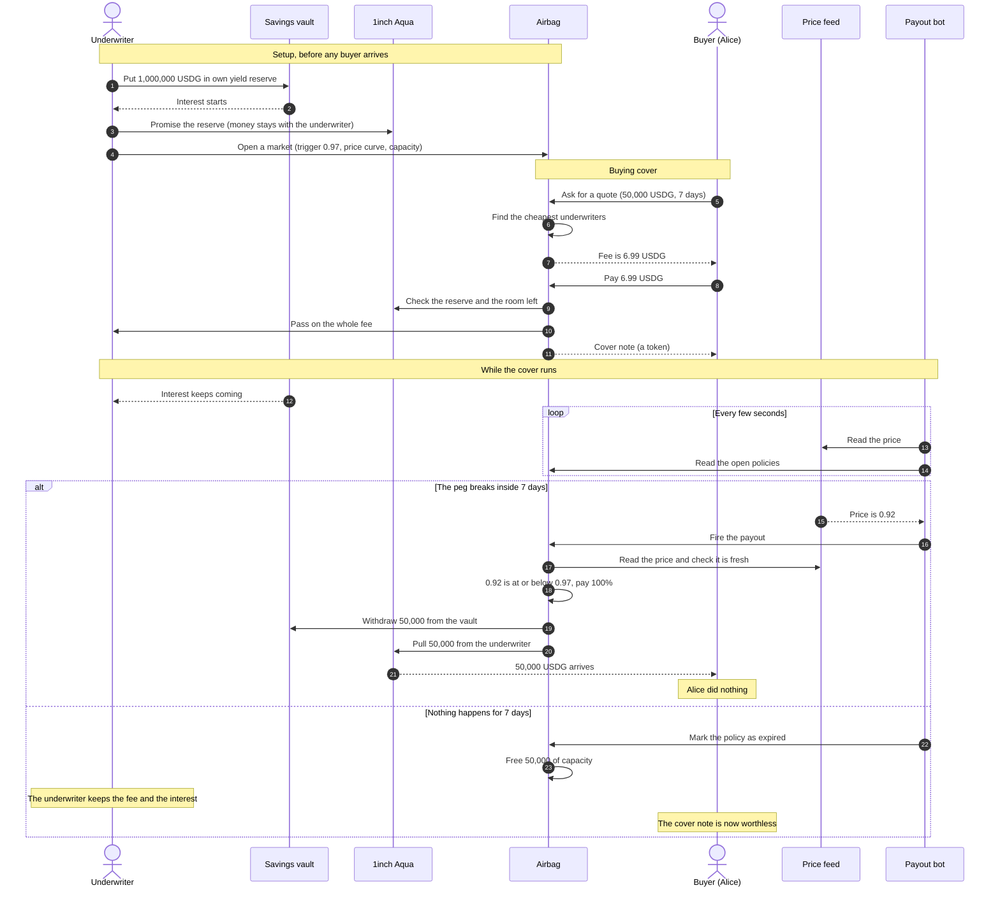
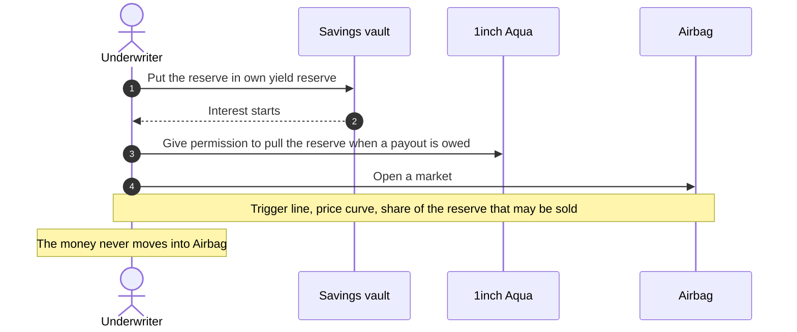
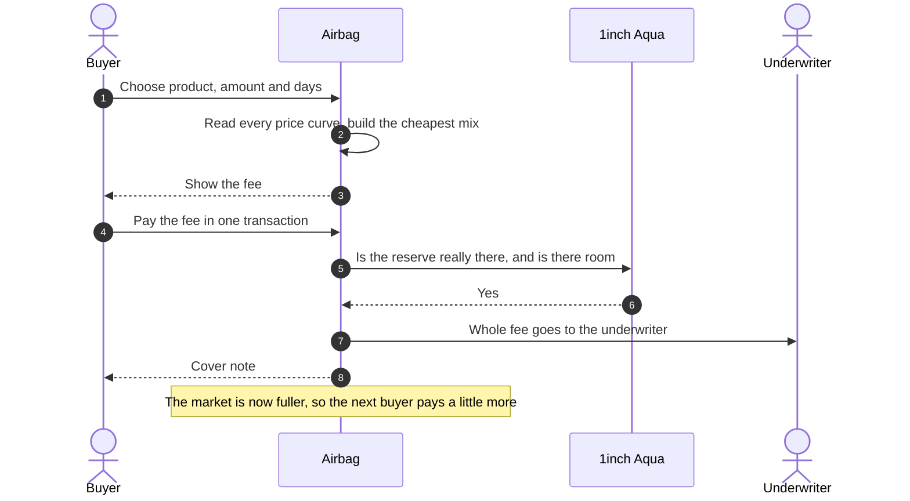
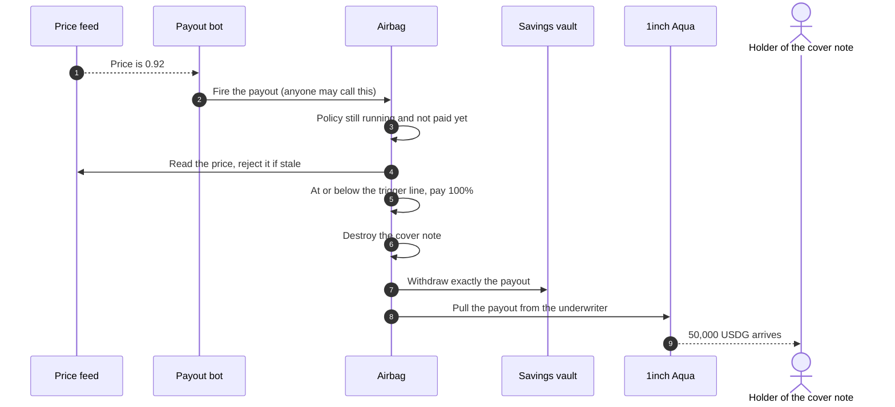
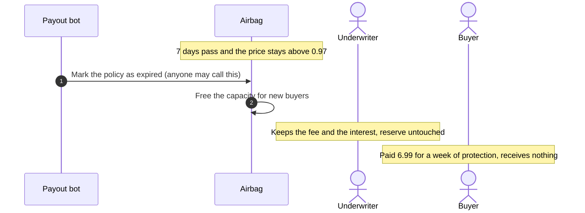

# Airbag: step by step

How one policy lives, from the underwriter's setup to the payout or the expiry. The example is the one
from the pitch: Alice insures 50,000 USDG for 7 days and pays 6.99 USDG.

## The whole flow

## The same flow, one part at a time

### 1. The underwriter sets up

### 2. The buyer buys cover

### 3a. The trigger fires

### 3b. Nothing happens

## Who ends up with what

| | Peg breaks | Nothing happens |
|---|---|---|
| Buyer | Paid 6.99, received 50,000 | Paid 6.99, received nothing |
| Underwriter | Received 6.99 plus interest, paid 50,000 | Keeps 6.99 plus interest |
| Airbag | Its share of the 6.99, if a fee is set | Its share of the 6.99, if a fee is set |

## Things the diagrams do not show

- **Events are recorded when they are seen.** Anyone (in practice the payout bot) calls `poke` on a
  market. While the trigger is true it records an episode; when it is false again, it closes it. A
  policy whose cover saw an episode begin is paid for it, even after the price has recovered, and up
  to 3 days after the policy expired. A dip that nobody recorded and that is already over still pays
  nothing.
- **No cover for an event already under way.** Buying is refused while the trigger is true, and while
  a recorded episode has not been seen to end.
- **Proportional payouts top up.** For the stock and LP products, a payout fired early is not final:
  if the loss deepens later in the term, the difference is paid then. The policy closes once it has
  paid in full or its term is over.
- **The reserve is not locked.** The underwriter can move their money at any time. Airbag then stops
  selling their cover, but a payout on cover already sold would fail.
- **Airbag can keep a share of each premium.** The owner sets the share (20% at most) and where it
  goes. It is taken out of the premium, so the buyer's price does not change and the underwriter
  receives the rest. Payouts are never charged. The share is 0 until the owner sets it, and the
  contracts live on Arbitrum Sepolia were deployed before this existed, so they take no fee.
- **The underwriter sets buying rules.** `setBuyRules` sets the shortest and longest term their market
  sells and a waiting period before cover starts (0 = none). The term starts after the wait, and an
  event that began during the wait is not covered.
- **Not live yet.** The fee, the buying rules, recorded events and top-ups are in the code and tested,
  but the contracts live on Arbitrum Sepolia were deployed before them.
- **The other two products work the same way** with a different trigger: a Uniswap v4 hook measures a
  liquidity provider's loss, and a price feed measures a stock's fall. Both can pay a share of the
  cover, where the depeg always pays all of it.
